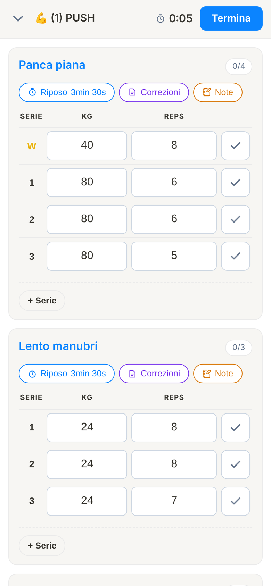
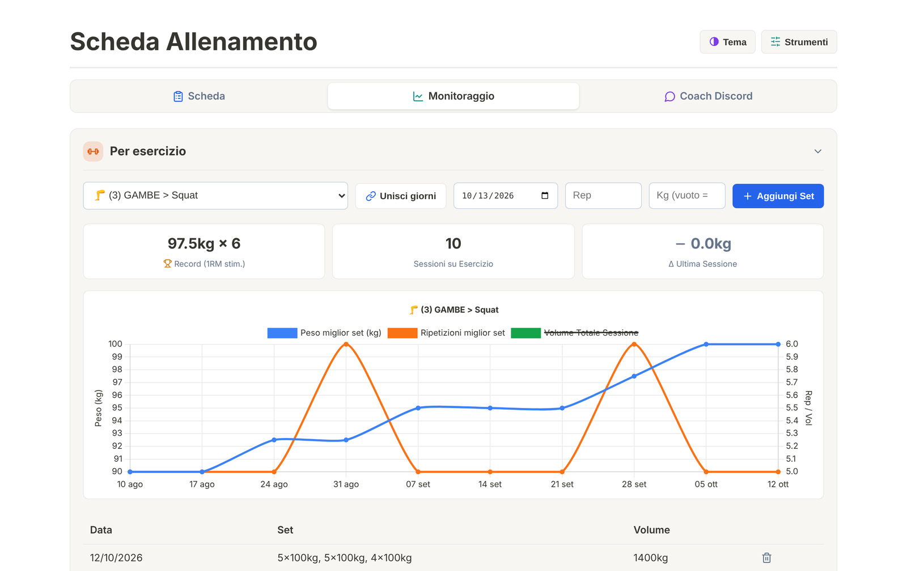
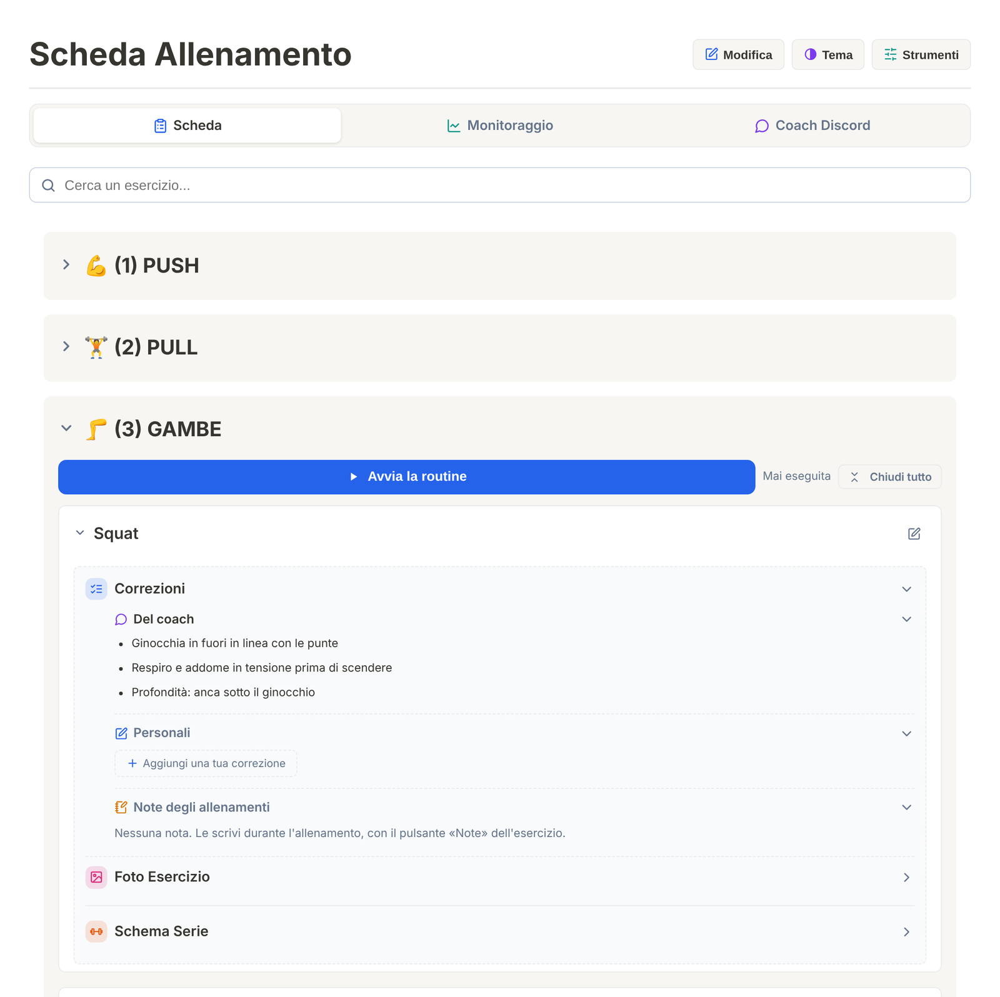

# Allenamento

Web app per seguire una scheda di allenamento in palestra: guida la sessione serie per serie, registra i carichi e mostra i progressi nel tempo. Tiene insieme anche le correzioni del coach e un assistente IA che le applica alla scheda.
L'ho progettata e sviluppata da solo con **Claude Code** e la uso in palestra dal telefono.

**Online:** [allenamento-ale.web.app](https://allenamento-ale.web.app) · l'accesso è riservato al mio account Google, perché contiene i miei dati. Le schermate qui sotto usano una scheda e uno storico di esempio.

## Cosa fa

- **Scheda per giorni** (per esempio Push, Pull, Gambe), modificabile e riordinabile con il trascinamento, anche da telefono.
- **Allenamento dal vivo**: avvii la routine e ogni esercizio parte già con i carichi e le ripetizioni dell'ultima volta. Spunti le serie, il timer di recupero parte da solo, e le serie di riscaldamento restano separate da quelle allenanti.
- **Correzioni del coach**, correzioni personali e note sotto ogni esercizio, consultabili anche durante la sessione, più le foto della macchina e della regolazione da ritrovare la volta dopo.
- **Monitoraggio**: per ogni esercizio record con 1RM stimato, numero di sessioni, differenza con l'ultima volta, grafico dell'andamento e storico completo.
- **Assistente IA (Gemini)**: gli incolli il feedback del coach e lui aggiorna la scheda (aggiunge correzioni, crea, rinomina o sposta esercizi, imposta serie e recuperi), chiedendo conferma prima delle modifiche importanti.
- **Coach**: archivio dei messaggi con il coach (importati da Discord) e una chat che risponde ai dubbi partendo da quei messaggi, con la ricerca web.
- **Sincronizzazione** tra PC e telefono, tema scuro e backup in JSON.

| Progressi di un esercizio | Correzioni nella scheda |
|---|---|
|  |  |

## Come è fatta

- **Un solo file HTML** con CSS e JavaScript, senza framework; grafici con **Chart.js**.
- **Firebase**: accesso con Google, dati e foto in Firestore, sito su Hosting. Le regole di sicurezza permettono la lettura e la scrittura solo al proprietario.
- **API di Gemini** per l'assistente e il coach. La chiave la inserisce l'utente e resta sul suo dispositivo, non è nel codice.

Come pubblicarla su un proprio progetto Firebase è spiegato in [ISTRUZIONI-FIREBASE.md](ISTRUZIONI-FIREBASE.md).

## Autore

Alessandro Pillot · [alessandropillot01@gmail.com](mailto:alessandropillot01@gmail.com)
